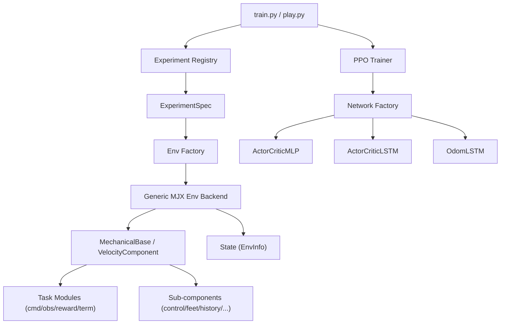

# MJX Refactor Architecture

This document records the architecture of the XG velocity project: a layered,
component-based design that decouples task logic from simulation mechanics so
new tasks can be added without growing one environment class.

## Goals

- Keep the current XG velocity behavior stable.
- Make robot assets, task logic, observations, rewards, terminations, control,
  and training entrypoints independently replaceable.
- Provide a clean component interface for porting additional locomotion tasks
  as MJX task modules.

## Runtime Flow



## Directory Layout

```text
src/
  cfg/experiments/      Experiment registry and descriptors
  components/
    base.py             BaseComponent ABC — 7 task-specific abstract methods
    mechanical_base.py  MechanicalBase — default implementations for all
                        mechanical methods (physics, contact, history, reset, etc.)
    factory.py          create_component() / list_components()
    subcomponents/      9 reusable mechanical sub-components:
      control.py              PD control, torque latency, MJX stepping
      domain_randomization.py DR pose/force wrapper around the sim step
      feet.py                 Contact filters and foot air/contact timers
      history.py              Observation/action history ring-buffers
      kinematics.py           Body-frame projection, joint reindexing
      perturbation.py         Velocity kicks, force/torque state machine
      physics.py              DR force approximation (mass/COM/inertia/friction)
      reset.py                Reset qpos/qvel construction, info reset on done
      topology.py             Body/site/geom ID resolution from string names
    tasks/
      __init__.py        _TASK_REGISTRY = {"velocity": VelocityComponent}
      velocity/          Velocity-tracking task implementation
        __init__.py        VelocityComponent(MechanicalBase)
        commands.py        sample_velocity_command()
        observations.py    48D actor / 72D privileged obs builder
        rewards.py         11 reward terms + VelocityRewardContext
        terminations.py    4 termination conditions
  envs/
    base.py             BaseEnv ABC — reset() / step() / render()
    state.py            State (flax.struct) — data, obs, reward, done, metrics, info
    info.py             EnvInfo + ContactState + HistoryBuffers + PerturbationState
                        (flax.struct.dataclass, JAX pytree-registered)
    info_compat.py      info_to_dict() / dict_to_info() — EnvInfo ↔ flat dict bridge
    factory.py          build_env(experiment, **overrides)
    backends/
      generic_env.py    GenericEnv(ViewerMixin, BaseEnv) — step() 15-phase pipeline
      viewer.py         ViewerMixin — MuJoCo passive viewer, multi-robot scene, video
  networks/             Shared MLP, recurrent, and odom networks
  robots/               Robot specifications (XG)
  tasks/                Task specification metadata
  training/             PPO trainer (ppo.py)
```

## Class Hierarchy

```
BaseComponent (ABC)                        components/base.py
  │  7 abstract methods (task-specific):
  │    sample_command, build_observation, build_reward_context,
  │    compute_rewards, compute_terminations, write_termination_info
  │  1 optional hook:
  │    compute_stateful_rewards (default: no-op)
  │  2 concrete validators:
  │    validate, validate_reward_scales
  │
  └─ MechanicalBase                        components/mechanical_base.py
       │  12 default implementations:
       │    step_physics, _execute_physics (template method),
       │    update_contact_state, update_history, update_action_state,
       │    reset_state, reset_history, extract_base_state,
       │    get_odom_observation, finalize_reward, apply_perturbation
       │  2 still-abstract (mixed concern):
       │    build_initial_info, maybe_resample_command
       │  1 property:
       │    default_pose_mjx
       │
       └─ VelocityComponent               components/tasks/velocity/__init__.py
            Task-specific overrides:
              sample_command, build_observation, build_reward_context,
              compute_rewards, compute_terminations, write_termination_info,
              compute_foot_swing_height_reward, compute_stateful_rewards
            Physics override:
              _execute_physics (custom PD + torque latency)
            Mixed-concern overrides:
              build_initial_info, maybe_resample_command
```

## EnvInfo Type Schema

`EnvInfo` (`flax.struct.dataclass`) replaces the former `dict[str, Any]` for the
environment info bus.  Nested sub-structures provide logical grouping:

| Sub-struct | Fields |
|---|---|
| `ContactState` | `last_contact`, `feet_air_time`, `feet_contact_time`, `peak_heights` |
| `HistoryBuffers` | `dof_pos_history`, `dof_vel_history`, `rpy_history`, `ang_lin_history`, `torque_his` |
| `PerturbationState` | `push_FM_active`, `push_FM_step_count`, `push_force`, `push_torque` |

Top-level fields: counters, command (3D), DR factors (11), control state (5),
RNG, termination flags (10), odometry (2), rewards dict, cumulative accumulators.

A `info_compat.py` bridge layer (`info_to_dict` / `dict_to_info`) allows
sub-components to continue using flat dict access during the migration period.

## Extension Mapping

The current implementation registers a single task. To add another locomotion
task, follow **Creating a New Task** below: a new task component goes under
`components/tasks/`, a new task spec under `tasks/`, and a new experiment under
`cfg/experiments/`.

| Task | Task component | Notes |
| --- | --- | --- |
| XG velocity (current) | `components/tasks/velocity/` | 3D velocity command, 48D actor obs, 72D critic obs, 11 reward terms, 4 termination conditions |

## Creating a New Task

1. **Create task directory**: `src/components/tasks/my_task/`
2. **Implement task component**:
   ```python
   from components.mechanical_base import MechanicalBase

   class MyTaskComponent(MechanicalBase):
       name = "my_task"
       # ... implement 7 abstract methods from BaseComponent
       # ... override build_initial_info, maybe_resample_command
   ```
3. **Register**: Add to `_TASK_REGISTRY` in `src/components/tasks/__init__.py`
4. **Add experiment spec**: Create `src/cfg/experiments/my_task.py`
5. **Add robot spec** (if needed): Create `src/robots/my_robot.py`

The mechanical methods (physics stepping, contact tracking, history buffers,
reset logic, PD control, perturbation, DR forces) are inherited from
`MechanicalBase` and work out of the box.

## Registered Experiments

Only `xg_velocity` is currently registered as a runnable experiment, in
`src/cfg/experiments/__init__.py`. Add new experiments by writing a builder
that returns an `ExperimentSpec` and registering it in `_EXPERIMENTS`.

## Current Entry Points

- Training: `python src/train.py --exp xg_velocity ...`
- Inference: `python src/play.py --exp xg_velocity --checkpoint <path> ...`
